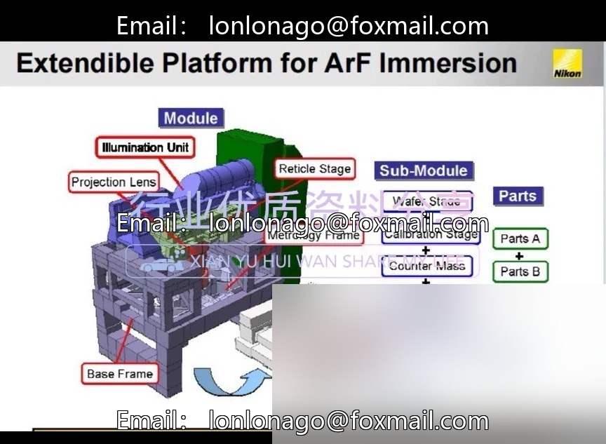
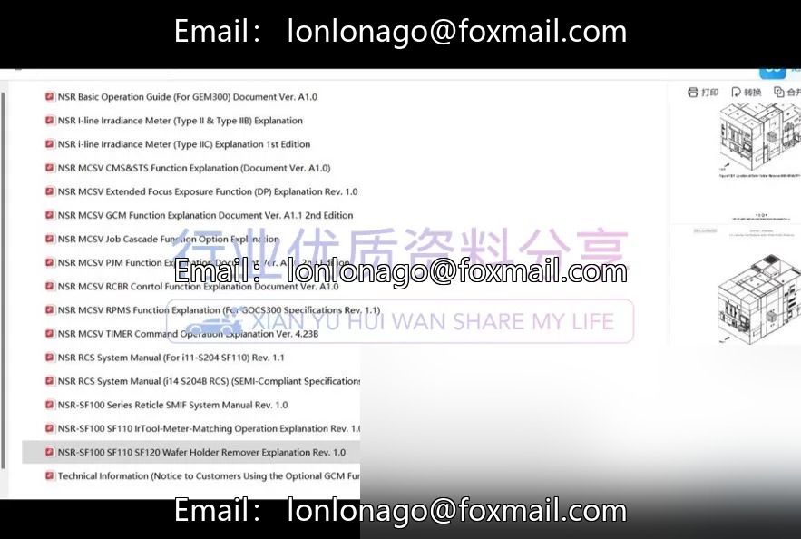
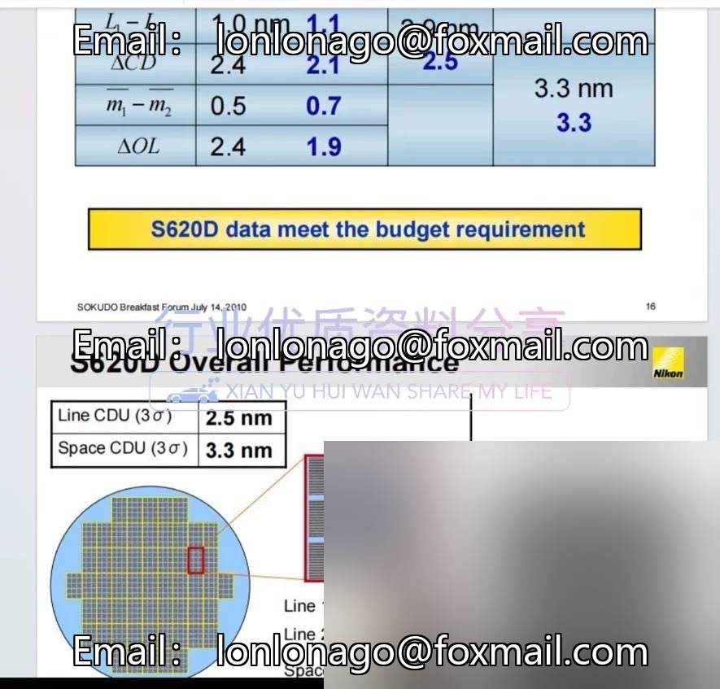
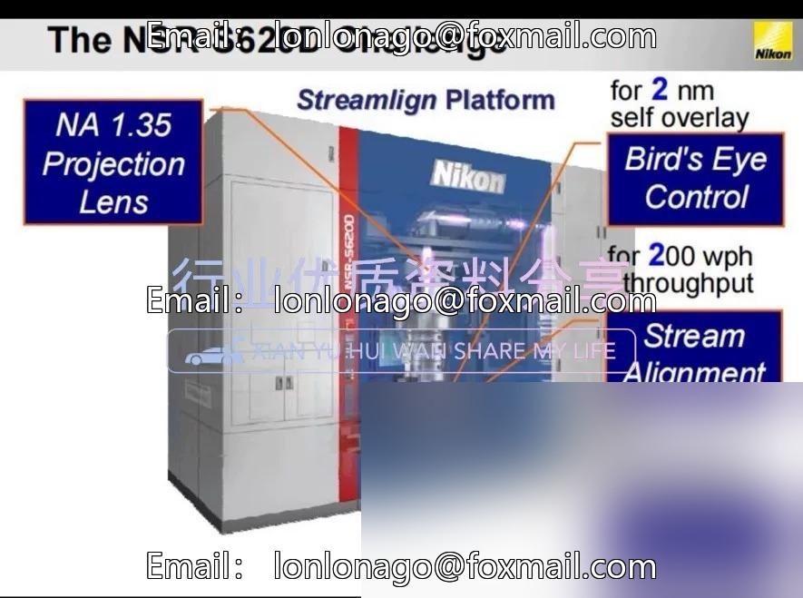
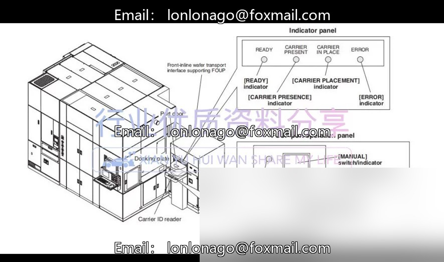
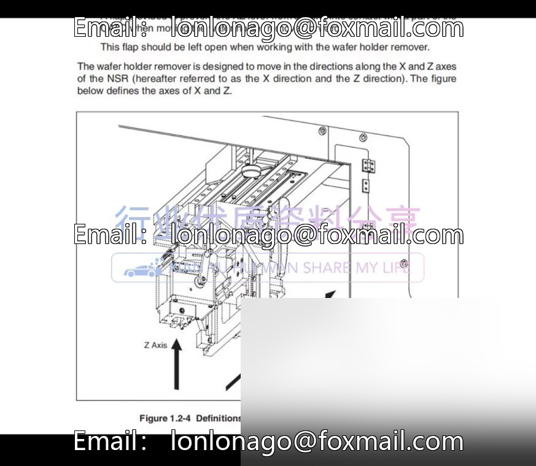

# Photolithography machine: Nikon photolithography machine complete set of materials; guide handbook (operation guide) 17 files!

## Body

Etching machine: Nikon etching machine complete materials; Guide manual (operational guide) 17 files! Very scarce!

Capture and send the electronic original directly! The following images include screenshots of the file portion. Please confirm before placing the order! Due to the replicable nature of electronic documentation Therefore, are allowed after purchase! Thanks for understanding!

For personal learning and reference use only.

Nikon's complete materials and guide manual are included, covering operation instructions, laser, metrology and exposure function explanations, along with specific file and layout details in the images.

<!-- AI_ENRICHED -->

## Images

## Payment

Here is a pay link on Stripe ( https://buy.stripe.com/3cs8yP7sY87d0vu9AB ). Please contact me lonlonago@foxmail.com after funding $89, and I will send you a complete data files , thank you!

